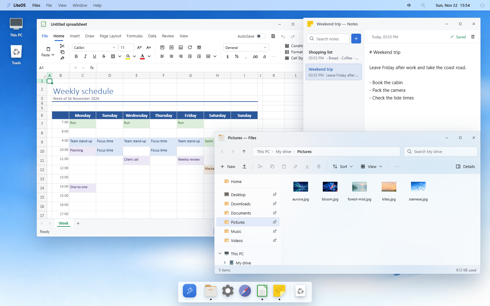

# LiteOS

LiteOS brings a desktop experience to the web. Open it in a browser and you get a full desktop: overlapping windows, a dock, a launcher, files and folders, and apps to work with them. Nothing is installed on the device you use it from.

**Note:** LiteOS is meant for closed networks, such as a local network or one reached through a VPN. Running it on the public internet hasn't been fully tested or observed yet, so we advise against it. If you do host it publicly, you do so at your own risk.



## The desktop

Apps open in windows that you can move, resize, minimise and switch between, the way they do on a desktop computer. Windows snap to halves and quarters of the screen, and hovering over an app in the taskbar shows its open windows. A reload brings back the windows that were open. A dock and a launcher start apps. Quick settings, dialogs and notifications all come from the shell, so every app looks and behaves alike. The screen can be locked, and you can change the wallpaper, theme, transparency effects and accessibility settings in Settings

What each app does, and how to build your own, is in [docs/apps](docs/apps/README.md).

## Files

Your files are real files and folders on the server, not entries in a database. The drive starts with the usual folders: Desktop, Documents, Downloads, Pictures, Music and Videos. Deleting a file moves it to the trash, and you can restore it from there. Recently opened files are kept, and folders you use often can be pinned to Quick access. Double-clicking a file opens it in the app for its type, and Open with lets you choose a different app. A guest's files are the exception: they stay in the browser on the device the guest used.

## Accounts

There are four kinds of account:

- **Administrators** manage accounts and the system, and can do everything else too.
- **Standard users** can do everything except manage accounts and the system.
- **Local accounts** are limited: their own look and basic settings, and a drive with a smaller default quota, but no device settings. An administrator chooses, for each one, whether it has web access, which apps it can open, and whether it can change its own name and password.
- **Guest** is one built-in account with no password, off until an administrator turns it on. Then anyone can choose "Sign in as guest" on the sign-in screen. A guest can't lock the screen, and its files and settings are kept in the browser on that device, not on the server.

The server enforces each of these limits; the desktop and Settings simply leave out what an account can't use.

## On a LiteLink device

LiteOS can run on a [LiteLink](https://github.com/ibnsultan/litelink) thin client. There it uses the device itself: USB drives show up in Files and in the Open and Save dialogs, documents print on the device's printers, and the device's sound, network, Bluetooth and power buttons are in the desktop and in Settings. On an ordinary computer none of this shows.

## Security

Each account signs in with its own password, and repeated wrong passwords lock the account out for a while. Changing a password signs the account out everywhere else. Sign-ins, lockouts, account changes and anything a limited account was refused are written to a security log of their own. When LiteOS fetches something from the web for you (downloads, the Browser, live TV), it refuses addresses on the local network and limits how much each account can ask for.

## Get started

**You need** PHP 8.3 or newer, Composer, Node.js with npm, and MySQL 8 or SQLite.

1. Get the code, then create your settings file from the example:

   ```bash
   cp .env.example .env
   ```
2. Set up a database in `.env` whether sqlite or mysql
3. Install everything and set up the database:

   ```bash
   composer run setup
   ```

   This installs the PHP and JavaScript packages, creates the app key, runs the migrations and builds the front end.
4. Put the libraries the apps use in place:

   ```bash
   npm run vendor
   ```
5. Serve the `public` folder with your web server, or for a quick try:

   ```bash
   php artisan serve
   ```

   Set `APP_URL` in `.env` to the address you use.
6. Open LiteOS in a browser. The first time, it walks you through setup and creating the administrator account.

## Credits

LiteOS is built with these projects. Thank you to everyone who makes them.

**Stack**

- PHP 8.3+
- [Laravel](https://laravel.com) 13
- [MySQL](https://www.mysql.com) or [SQLite](https://sqlite.org) for accounts and settings
- [React](https://react.dev) and [TypeScript](https://www.typescriptlang.org) for the office apps

**Libraries in the apps**

- [PDF.js](https://mozilla.github.io/pdf.js/): reading PDFs in PDF Viewer
- [pdf-lib](https://pdf-lib.js.org): organising pages, combining files and pictures, and saving changes in PDF Viewer
- [CodeMirror](https://codemirror.net): the editor in Code
- [hls.js](https://github.com/video-dev/hls.js): live TV streams in Media
- [sql.js](https://sql.js.org): SQLite compiled to WebAssembly, in Database
- [mdb-reader](https://github.com/andipaetzold/mdb-reader): importing Access databases in Database
- [buffer](https://github.com/feross/buffer): binary data for the Access import
- [nspell](https://github.com/wooorm/nspell) and [dictionaries](https://github.com/wooorm/dictionaries) (English, British English, Spanish, French and Dutch): spelling in the office apps
- [Hyphen](https://github.com/ytiurin/hyphen): hyphenation in Documents
- [Popover polyfill](https://github.com/oddbird/popover-polyfill): menus and popovers in the office apps

**Fonts**

[Inter](https://rsms.me/inter/), [Plus Jakarta Sans](https://github.com/tokotype/PlusJakartaSans), [Libre Franklin](https://github.com/impallari/Libre-Franklin), [Work Sans](https://github.com/weiweihuanghuang/Work-Sans), [DM Mono](https://github.com/googlefonts/dm-mono), [Red Hat Mono](https://github.com/RedHatOfficial/RedHatFont) and [Cutive Mono](https://fonts.google.com/specimen/Cutive+Mono), used by the Slides themes, under the SIL Open Font License.

**Icons**

The system icons come from the [We10X](https://github.com/yeyushengfan258/We10X-icon-theme), [Vimix](https://github.com/vinceliuice/vimix-icon-theme) and [Uniform](https://github.com/zayronxio/Uniform-icon-theme) icon themes.

**Tools**

- [Composer](https://getcomposer.org) and [npm](https://www.npmjs.com)
- [Vite](https://vite.dev) with [laravel-vite-plugin](https://github.com/laravel/vite-plugin) and [@vitejs/plugin-react](https://github.com/vitejs/vite-plugin-react), [esbuild](https://esbuild.github.io) and [Tailwind CSS](https://tailwindcss.com)
- [PHPUnit](https://phpunit.de), [Mockery](https://github.com/mockery/mockery), [Faker](https://fakerphp.org) and [Vitest](https://vitest.dev) for tests
- [Laravel Pint](https://laravel.com/docs/pint), [Pail](https://github.com/laravel/pail), [Tinker](https://github.com/laravel/tinker), [Boost](https://github.com/laravel/boost), [PAO](https://github.com/laravel/pao) and [Collision](https://github.com/nunomaduro/collision)
- [concurrently](https://github.com/open-cli-tools/concurrently)
