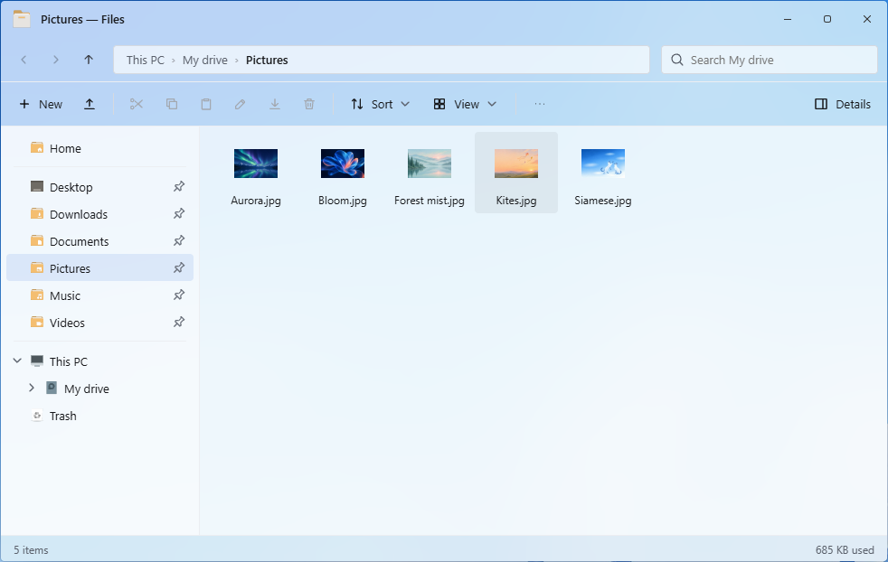
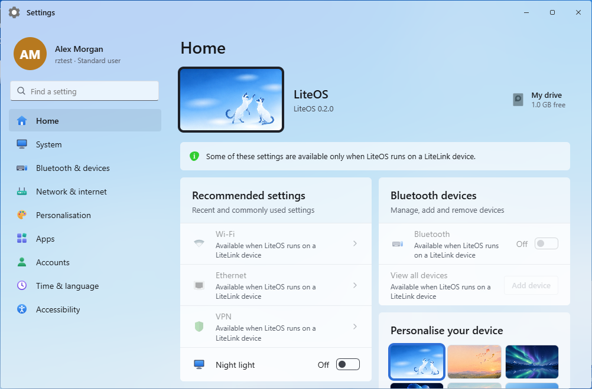
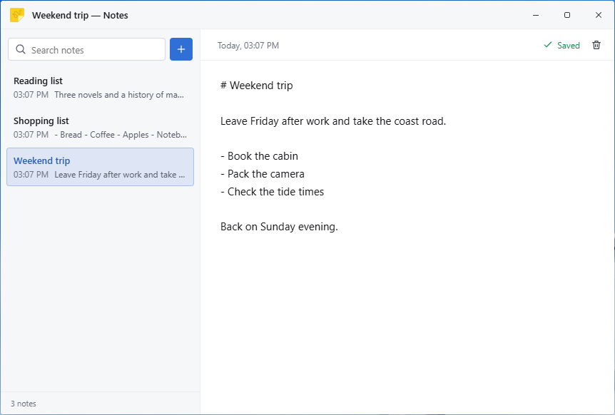
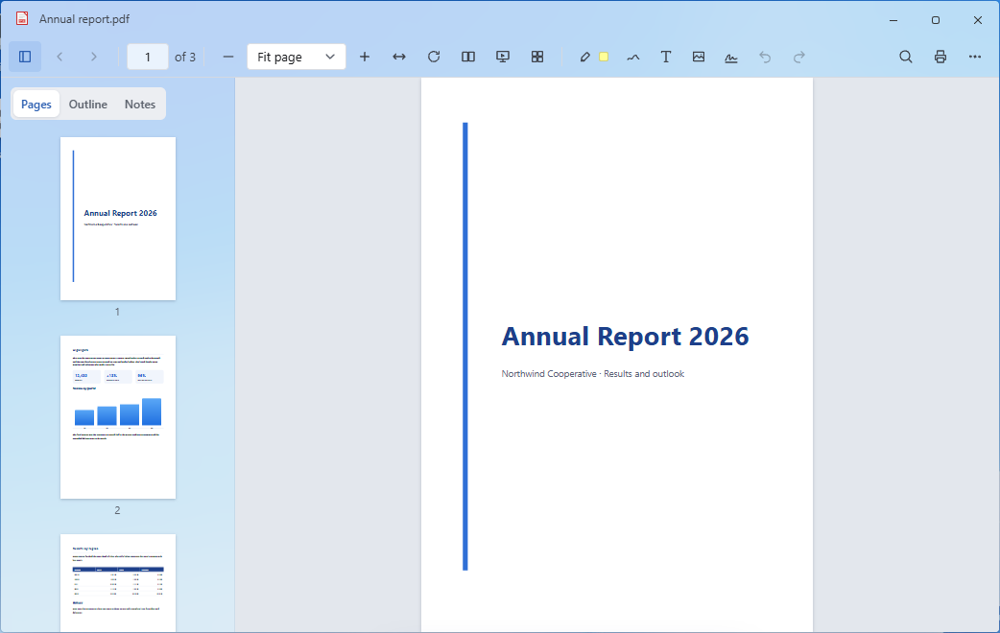
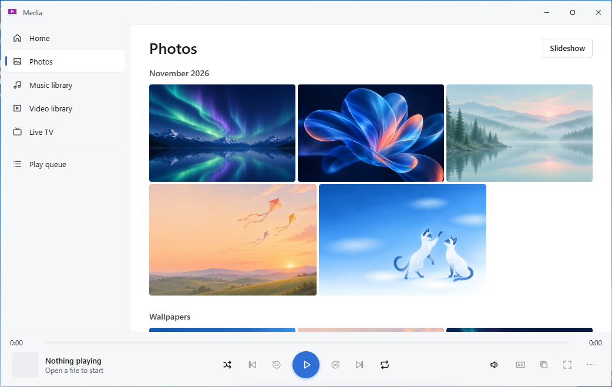
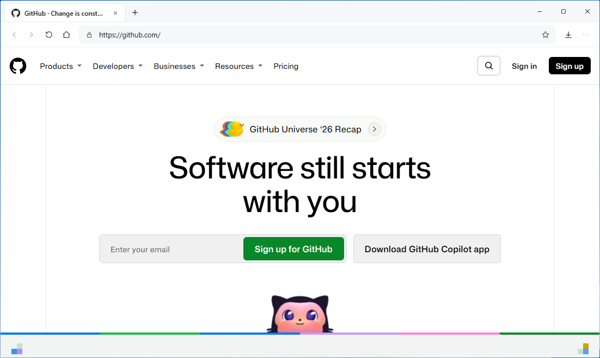
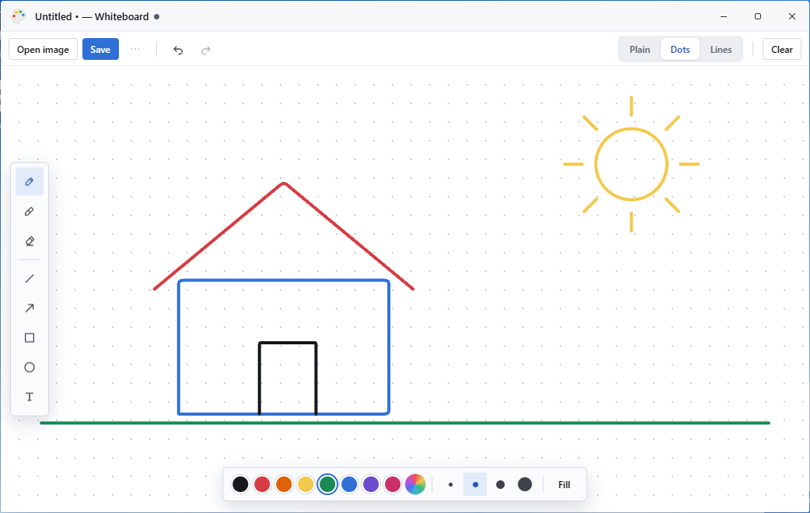
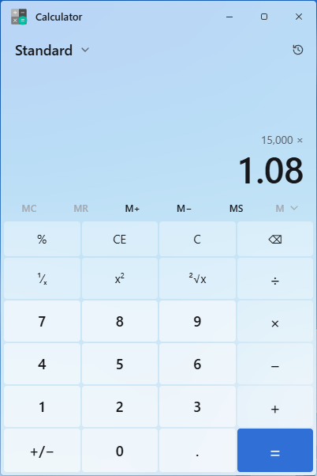
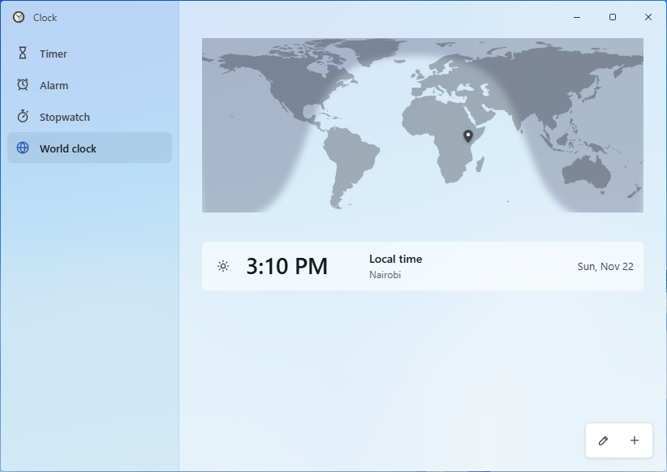

# Apps

Every app opens in its own window on the desktop. Start one from the launcher, the dock or taskbar, or by double-clicking a file: each kind of file opens in the app made for it, and **Open with** in Files lets you choose another.

These apps have their own pages:

- [Code](code.md): a code editor with a live preview, a console and a terminal
- [Documents](office/documents.md): documents with real pages, and Word files
- [Sheets](office/sheets.md): spreadsheets with formulas, and Excel workbooks
- [Slides](office/slides.md): slide decks and presentations, and PowerPoint files
- [Database](office/database.md): databases you design and fill in, saved as SQLite files

To build an app of your own, see [Building an app](development/new-app.md), and [Apps on a LiteLink device](development/litelink.md) for USB drives and printing.

Notes and Whiteboard are still in development, and six more apps are planned: see [Coming next](#coming-next).

## Files

The file manager. The left pane works like Explorer's: Home, the folders pinned to Quick access, This PC with your drive and any USB drives, and the Trash.

- Create folders, documents, spreadsheets, presentations and text files with **New**. They're named in place, without a dialog.
- Upload files from your computer, download them, and drag them between folders and onto the desktop.
- Cut, copy, paste, rename and move to the Trash. Items in the Trash can be restored or deleted for good.
- Sort and change the view, open the details pane, and see a file's properties.
- Pin folders to Quick access, and set a picture as the wallpaper.

## Settings

Where you set up LiteOS and your account. It's grouped like this:

- **System**: display and night light, sound, notifications and Focus, power, storage, and the device's specifications
- **Bluetooth & devices**: Bluetooth devices, USB drives, printers and the mouse pointer
- **Network & internet**: Wi-Fi, Ethernet and VPN
- **Personalisation**: background, colours and theme, the dock or taskbar, desktop icons
- **Apps**: installed apps, and which app opens each kind of file
- **Accounts**: your details, your password, and, for administrators, other users and the guest account
- **Time & language**: time zone, clock format, language and keyboard
- **Accessibility**: text size, pointer size, contrast, animations and more

Device settings such as Bluetooth, network and printers only work when LiteOS runs on a LiteLink device. On an ordinary computer they're shown greyed out.

## Notes

> **Still in development.** Notes and Whiteboard are getting a full revamp.

Quick notes. Each note is a text file in the **Notes** folder of your drive, so it can also be opened in Code or any other text app. Notes save on their own as you type. Search finds notes by their text.

## PDF Viewer

Reads PDF files.

- Page thumbnails and the document's outline in the side pane, search, zoom, and presentation view
- Print, and save a copy
- Organise pages: rotate, remove, and add a blank page, a picture or pages from another PDF, or pull pages out into a new PDF
- Add a signature you draw or take from a picture
- Opens password-protected PDFs

Scripts inside a PDF never run, and links to the web ask before they open.

## Code

A code editor laid out like a desktop IDE, with a live preview for HTML and Markdown, a console and a terminal. See [Code](code.md).

## Media

Plays photos, music and videos from your drive, and live TV.

- Play a file, a whole folder or a queue, and make playlists
- Add subtitles to a video, and save a frame to the Pictures folder
- A mini player and full screen
- Live TV: add a stream or a playlist address and its channels appear in the list

## Browser

Browses the web in tabs.

- A new tab page with shortcuts, and a choice of search engine: Google, Bing, Brave Search or Wikipedia
- History, and downloads that are saved to the **Downloads** folder of your drive
- Save a page, a link, a picture, or a video or sound, straight to your drive

## Whiteboard

> **Still in development.** Notes and Whiteboard are getting a full revamp.

Sketch, write and mark up pictures. Draw with a pen or highlighter, add lines, arrows, rectangles, ellipses and text, and erase. There are eight colours, four line sizes, and a dotted, lined or plain background. Open a picture to draw on it. Boards are saved as PNG pictures.

## Calculator

Standard, scientific and programmer calculations, date differences, and unit conversions. It keeps a history and a memory, and remembers the mode you used last.

## Clock

Alarms, timers, a stopwatch and world clocks. Alarms and timers ring even when the Clock window is closed, as long as LiteOS is open. A running timer or stopwatch keeps going while Clock is closed.

## Coming next

### In development

**Notes** and **Whiteboard** are getting a full revamp. They keep working in the meantime.

### Planned

These six utilities haven't been started yet.

| App            | What it will do                                                                                          | Also brings                                                                                                  |
| -------------- | -------------------------------------------------------------------------------------------------------- | ------------------------------------------------------------------------------------------------------------ |
| Archives       | Browses, extracts and creates compressed archives. Works with ZIP, TAR and GZIP, and opens 7z and RAR.   | **Compress** and **Extract** in Files, and limits on extraction size that administrators can set |
| System Monitor | Shows running apps, performance and storage, and for administrators, the server and the LiteLink device. | Tasks in the app SDK                                                                                         |
| Screenshot     | Captures the screen, marks up the picture, and records the screen.                                       | Shortcut keys in the desktop                                                                                 |
| Calendar       | Keeps events in several calendars, with repeats and reminders. Imports and exports `.ics` files.       | Uses the same reminders as Clock                                                                             |
| Character Map  | Browses characters and copies them, keeps favourites, and previews fonts.                                |                                                                                                              |
| Terminal       | A command line for your files, shared with Code, with LiteOS commands and scripts.                       | There still alot of planning with this one.                                                                  |
