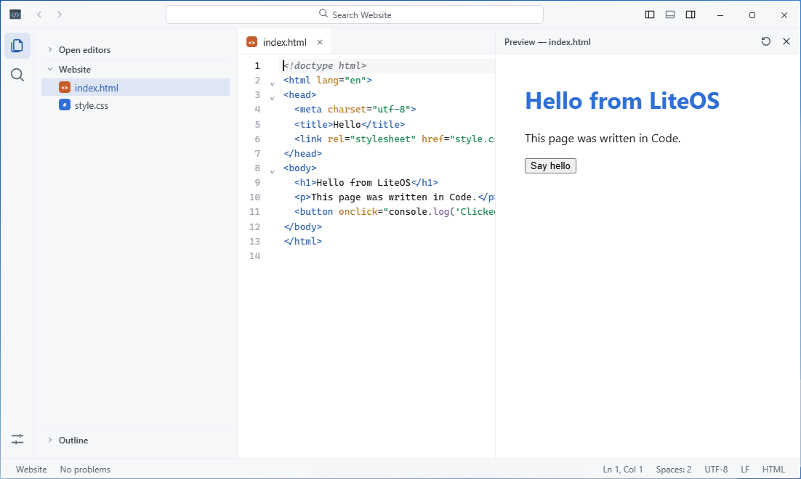

# Code

A code editor laid out like a desktop IDE, for web pages, scripts and any text file on your drive.

## Files

Code opens text and code files: HTML, CSS, JavaScript and TypeScript, JSON, Markdown, PHP, Python, plain text, logs and more. Open a single file, or a whole folder as a project.

Files larger than 8 MB aren't opened, and files over 2 MB open without highlighting.

## The window

- **Explorer:** the open folder as a tree, with new files and folders, rename, move to the Trash, and **Open editors**
- **Search:** find text across every file in the folder
- **Tabs:** several files open at once; a dot marks unsaved changes
- **Live preview:** HTML and Markdown shown beside the code as you type
- **Bottom panel:** the terminal, the console, problems and output
- **Status bar:** line and column, indentation, encoding, line endings and the language

## Editing

- Highlighting for HTML, CSS, JavaScript and JSX, TypeScript and TSX, JSON, Markdown, PHP, Python, SQL, XML, YAML, shell scripts, C and C++, Java and INI files
- Several cursors, moving and duplicating lines, folding, matching brackets and go to line
- A command palette, and go to file by name
- Indent with spaces or tabs, word wrap, and LF or CRLF line endings
- When a file changes on the drive while it's open, Code tells you

## Preview and console

The preview shows the page from the open folder, with its stylesheets, scripts and pictures. What the page writes with `console.log`, and any errors, appear in the **Console** panel. You can also type JavaScript into the console, and it runs in the preview page. The preview runs in a locked-down frame, so a page can't reach your files or the rest of LiteOS.

## Terminal

The terminal has a fixed set of file commands. They work inside the open folder only, through the same file access as the explorer. It isn't a server shell: nothing typed here runs on the server, and there are no pipes, redirection, variables or network commands.

| Command                                         | What it does                                         |
| ----------------------------------------------- | ---------------------------------------------------- |
| `help`                                        | Lists the commands                                   |
| `pwd`                                         | Shows the current folder                             |
| `ls [path]`                                   | Lists a folder                                       |
| `cd [path]`                                   | Changes folder (no path: back to the project folder) |
| `tree [path]`                                 | Shows a folder and everything in it                  |
| `cat <file>`                                  | Shows a file                                         |
| `head [-n N] <file>` / `tail [-n N] <file>` | Shows the first or last lines of a file              |
| `find [path] [-name pattern]`                 | Finds files by name (`*` and `?` wildcards)      |
| `grep [-i] <pattern> [path]`                  | Searches file contents                               |
| `mkdir [-p] <folder>`                         | Creates a folder                                     |
| `touch <file>`                                | Creates an empty file                                |
| `cp [-r] <from> <to>`                         | Copies                                               |
| `mv <from> <to>`                              | Moves or renames                                     |
| `rm [-r] <path…>`                            | Moves to the Trash                                   |
| `open <file>`                                 | Opens a file in a tab                                |
| `run`                                         | Refreshes the live preview                           |
| `clear`                                       | Clears the terminal                                  |

## To do: running PHP, Python and SQLite

As of now Code edits PHP, Python and SQL files but can't run them. The plan is to run them in the browser with WebAssembly, the way Database already runs SQLite.

**How it would work**

- Each language has a runtime compiled to WebAssembly. Code loads it the first time a file of that kind is run, and the browser keeps it cached after that.
- The runtime works in a background worker, so a long-running script never freezes the window, and it can be stopped.
- Before a run, the open folder's files are copied into the runtime's own in-memory file system, so a script can read and include them. Files the script writes are copied back to the folder when it finishes.
- What the script prints appears in the terminal and the console, and an HTML page a PHP script produces can show in the live preview.
- Everything runs on the device you're using. Nothing reaches the server, so a script has no more access than the editor itself.

**The pieces**

- [ ] **SQLite:** reuse the SQLite engine Database ships with (SQLite compiled to WebAssembly). Open a `.db` or `.sqlite` file, run the SQL file in the editor against it, and show the results as a table in the panel.
- [ ] **Python:** a Python runtime built for WebAssembly, with the standard library. Run a `.py` file with **Run**, or `python <file>` in the terminal.
- [ ] **PHP:** a PHP runtime built for WebAssembly. Run a `.php` file in the terminal, or open its output in the live preview as a page.
- [ ] A **Run** button and `python`, `php` and `sqlite` terminal commands that use them.
- [ ] Limits on run time and memory, and a **Stop** button.
