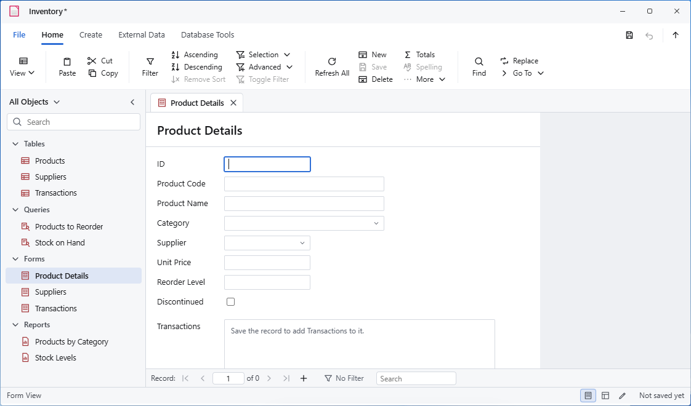

# Database

Design databases and fill them in, in the style of Access. A database is a single SQLite file.

## Files

- **Opens** database files (`.db`, `.sqlite`, `.sqlite3`). A `.db` file made in Database keeps its forms, reports and queries inside it.
- **Imports** text files (CSV and tab-separated), Excel workbooks (`.xlsx`), other SQLite files, and Access databases (`.accdb`, `.mdb`). From Access it brings in tables, data, relationships and the queries it can translate, but not forms, reports or macros.
- **Exports** a table, query or report to CSV or text, Excel, PDF, or straight into Sheets.

Open and Save As use your LiteOS drive and start in **Documents**. You can also open a file from the device you're using.

## What it can do

- **Tables** in a datasheet: sort, filter, find and replace, freeze and hide fields, and totals
- **Table Design:** field types, primary keys, indexes, validation, lookups, attachments and calculated fields
- **Relationships** between tables
- **Queries:** Query Design, the Query Wizard, SQL View, totals, parameters, action queries, and a SQL console
- **Forms:** forms, split forms, multiple-item forms, blank forms, Form Design and the Form Wizard
- **Reports:** the Report Wizard, labels, grouping and totals, Print Preview, printing and PDF
- **Database Tools:** Compact and Repair, integrity check, backup, Database Documenter, table and performance analysis, and object dependencies
- **Templates** on the New page to start from

## Saving and printing

Changes are saved to the drive on their own: each record is saved when you move off it. A new database is saved the first time you choose **Save**. **File** also has **Save a Copy** and **Back Up Database**. Reports print from Print Preview, or with Ctrl+P while one is open.

## Shortcuts

| Keys | Action |
| ---- | ------ |
| Ctrl+S / Ctrl+O / Ctrl+N | Save / Open / New |
| Ctrl+F / Ctrl+H | Find / Replace |
| F6 | Move between panes |
| F11 | Show or hide the navigation pane |
| F2 | Rename in the navigation pane |
| Ctrl+F4 | Close the open object |
| Ctrl+; | Today's date |
| Ctrl+' | Value from the record above (in forms) |
| F5 | Run (in the SQL console) |

## Not available

Macros and VBA, linked tables on database servers (such as SQL Server or ODBC), and sharing a database between people.
