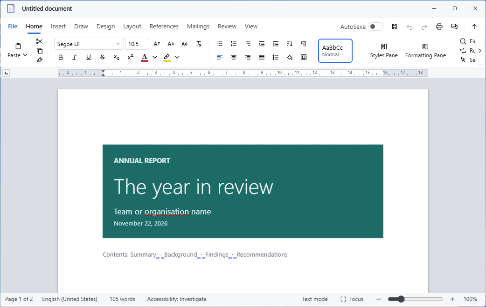

# Documents

A word processor with real pages, in the style of Word.

## Files

- **Opens** Word documents (`.docx`), LiteOS documents (`.ldoc`), and plain text and Markdown (`.txt`, `.md`).
- **Saves** as a Word document (`.docx`), so the file opens in Word too. A document protected with a password is saved as `.ldoc`.
- **Exports** a copy as PDF (with searchable text), a web page, Markdown or plain text.

Open and Save As use your LiteOS drive and start in **Documents**. You can also open a file from the device you're using.

## What it can do

- **Writing:** styles, lists, sorting, find and replace, and a style gallery you can change
- **Tables:** merge and split cells, borders, shading, header rows that repeat on each page
- **Pictures and objects:** pictures, shapes, icons, text boxes, WordArt, charts, SmartArt, equations, cover pages and signature lines
- **Pages:** headers and footers, page numbers, sections, columns, breaks, watermarks, line numbers, hyphenation and page borders
- **References:** footnotes and endnotes, a table of contents, captions, citations and a bibliography, an index
- **Review:** comments, Track Changes, Compare, Restrict Editing, spelling and grammar, a thesaurus, language, and an accessibility check
- **Mailings:** envelopes, labels, and mail merge from a CSV or Sheets file, to a new document, the printer or PDF
- **Draw:** pens and highlighters, an eraser, and Ink to Shape
- **Views:** Read Mode, Focus, Web Layout, Outline, Draft and Split; Text mode and the word count are in the status bar
- **Protection:** open read-only, encrypt with a password, or mark as final (**File › Info**)

## Saving and printing

**AutoSave** is on: once a document has been saved, changes are saved on their own a moment after you make them. Print from **File › Print** or the quick-access bar.

## Shortcuts

| Keys | Action |
| ---- | ------ |
| Ctrl+S | Save |
| Ctrl+Shift+S or F12 | Save As |
| Ctrl+O / Ctrl+N / Ctrl+P | Open / New / Print |
| Ctrl+F / Ctrl+H | Find / Replace |
| Ctrl+B / Ctrl+I / Ctrl+U | Bold / Italic / Underline |
| Ctrl+E / Ctrl+L / Ctrl+R / Ctrl+J | Centre / Left / Right / Justify |
| Ctrl+K | Insert a link |
| Ctrl+Shift+8 / Ctrl+Shift+7 | Bullets / Numbering |
| Ctrl+Alt+M | New comment |
| Alt+Ctrl+F / Alt+Ctrl+D | Footnote / Endnote |
| Ctrl+Shift+E | Track Changes |
| Ctrl+Shift+V | Paste as plain text |
| F7 / Shift+F7 | Spelling and grammar / Thesaurus |
| Ctrl+F1 | Collapse or expand the ribbon |

## Not available yet

Sharing a document with other people, digital signatures, and Ink to Math.
