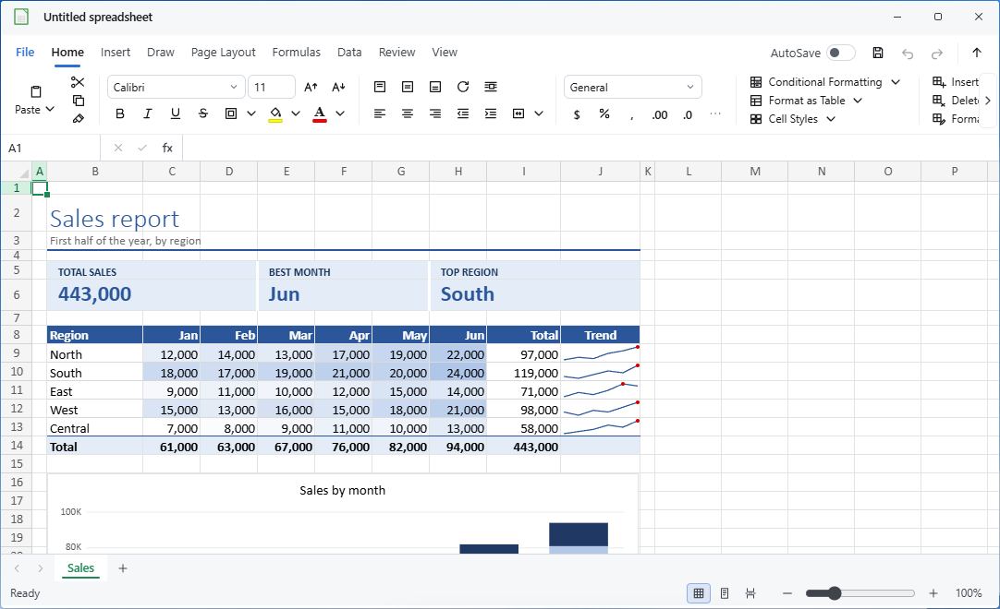

# Sheets

Spreadsheets with formulas, charts and PivotTables, in the style of Excel.

## Files

- **Opens** Excel workbooks (`.xlsx`, `.xlsm`), OpenDocument spreadsheets (`.ods`), CSV and tab-separated files (`.csv`, `.tsv`, `.txt`) and Sheets files (`.lsheet`).
- **Saves** as an Excel workbook (`.xlsx`) by default. Save As also offers a Sheets file, CSV (comma or semicolon), tab-separated text and PDF. CSV and text files hold only the current sheet.
- `.ods` files open as a copy and are saved in another format. `.xlsm` files open without their macros.
- **Exports** a PDF.

Open and Save As use your LiteOS drive and start in **Documents**. You can also open a file from the device you're using.

## What it can do

- **Formulas:** over 400 functions, Insert Function, named ranges, AutoSum, dynamic arrays and calculation options
- **Formatting:** number formats, borders, merged cells, conditional formatting, and tables with styles
- **Data:** sort and filter, import text and CSV, Text to Columns, Flash Fill, Remove Duplicates, data validation, Consolidate, subtotals, grouping, What-If Analysis and Forecast Sheet
- **PivotTables** with slicers
- **Charts:** column, bar, line, area, pie, doughnut, scatter and combo, plus sparklines
- **Objects:** pictures, shapes, icons, WordArt, links, notes and ink
- **Page Layout:** margins, orientation, print area, print titles, page breaks and themes
- **Review:** spelling, comments and notes, protecting a sheet or the workbook, and an accessibility check
- **View:** freeze panes, split, custom views, Page Break Preview, Focus Mode, full screen and the Watch Window

## Saving and printing

**AutoSave** is on: once a workbook has been saved, changes are saved on their own a moment after you make them. If a file you open has content Sheets can't show, AutoSave stays off for it, so nothing in the file is lost. Print from **File › Print**.

## Shortcuts

| Keys | Action |
| ---- | ------ |
| Ctrl+S / Ctrl+O / Ctrl+N | Save / Open / New |
| Ctrl+B / Ctrl+I / Ctrl+U / Ctrl+5 | Bold / Italic / Underline / Strikethrough |
| Ctrl+1 | Format Cells |
| F2 | Edit the cell |
| Alt+= | AutoSum |
| Shift+F3 / Ctrl+F3 | Insert Function / Name Manager |
| F9 | Recalculate |
| Ctrl+` | Show formulas |
| Ctrl+F / Ctrl+H | Find / Replace |
| Ctrl+G or F5 | Go To |
| Ctrl+Alt+V | Paste Special |
| Ctrl+Shift+L | Filter |
| Ctrl+E | Flash Fill |
| Ctrl+T | Make a table |
| Ctrl++ / Ctrl+- | Insert / Delete cells |
| Ctrl+9 / Ctrl+0 | Hide rows / Hide columns |
| Alt+Shift+Right / Alt+Shift+Left | Group / Ungroup |
| Ctrl+; | Today's date |
| Shift+F11 | New sheet |

## Not available

Macros (VBA) and Automate scripts, getting data from the web, sharing a workbook with other people, and version history.
