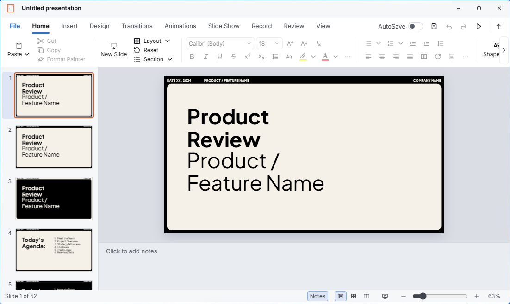

# Slides

Build and present slide decks, in the style of PowerPoint.

## Files

- **Opens** PowerPoint files (`.pptx`, `.pptm`, `.ppsx`, `.ppsm`, `.potx`, `.potm`, `.ppt`, `.pps`, `.pot`), OpenDocument presentations (`.odp`, `.otp`) and older Slides decks (`.lslides`). Anything other than `.pptx` opens as a copy.
- **Saves** as a PowerPoint presentation (`.pptx`).
- **Exports** a PDF, the slides as PNG or JPEG pictures, or a video (1080p, 720p or 480p).

Open and Save As use your LiteOS drive and start in **Documents**. You can also open a file from the device you're using.

## What it can do

- **Slides:** layouts, sections and templates
- **Content:** text, shapes, pictures, tables, charts, SmartArt-style diagrams, icons, equations, audio and video, with a Selection pane and a Format pane
- **Design:** themes and variants, backgrounds, slide size, the slide, notes and handout masters, and headers and footers
- **Transitions**, including Morph, and **animations** with the Animation pane
- **Slide Show:** presenter view, pen, highlighter and laser pointer, rehearsed timings and custom shows
- **Record:** narration for each slide
- **Review:** comments, spelling, a thesaurus, language and an accessibility check
- **Views:** Normal, Outline, Slide Sorter, Notes Page and Reading View

## Saving and printing

**AutoSave** is off to start with. Turn it on with the switch in the title bar, and changes are saved on their own a moment after you make them. Print slides, notes, the outline or handouts (one to nine slides a page) from **File › Print**.

## Shortcuts

| Keys | Action |
| ---- | ------ |
| F5 / Shift+F5 | Present from the start / from the current slide |
| Ctrl+M / Ctrl+D | New slide / Duplicate |
| Ctrl+G / Ctrl+Shift+G | Group / Ungroup |
| Ctrl+S / Ctrl+O / Ctrl+N | Save / Open / New |
| Ctrl+Z / Ctrl+Y | Undo / Redo |
| Ctrl+F / Ctrl+H | Find / Replace |
| F7 / Shift+F7 | Spelling / Thesaurus |
| F6 | Move between panes |
| Alt+P | Play or pause media |
| Page Up / Page Down | Previous / next slide |

## Not available yet

Sharing and working on a deck together, version history, and recording with the camera or microphone inside LiteOS. Some content in PowerPoint files, such as embedded objects and 3D models, isn't shown, but it's kept when the file is saved.
